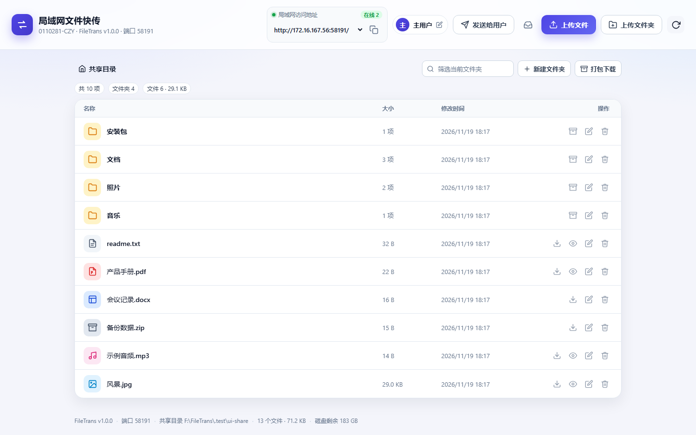
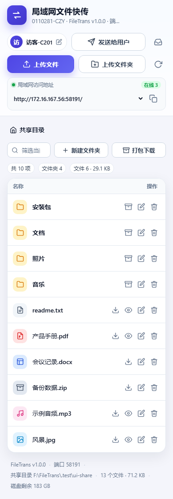
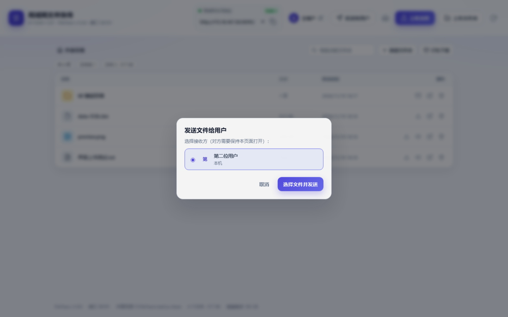
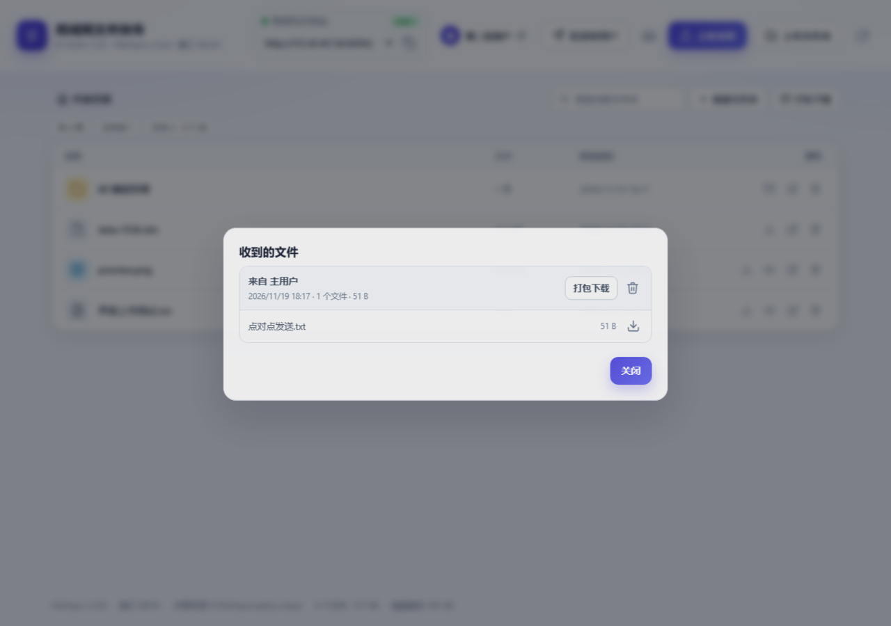

# 局域网文件快传（FileTrans）

一个用 **C# / ASP.NET Core** 编写的局域网文件互传工具：在电脑上双击脚本启动后，同一局域网内的手机、平板、其他电脑用浏览器打开提示的地址，即可互相收发文件，不需要安装任何客户端。

- **共享空间**：所有设备都能上传、下载、管理同一个共享目录。
- **点对点发送**：页面会显示当前在线的其他用户，选中对方后可直接把文件发送到他的收件箱，接收方收到未读提醒。



手机浏览器访问同一地址即可使用，界面自动适配小屏幕：



把文件发送给另一位在线用户：





## 功能特性

- **浏览器即用**：无需客户端，手机、平板、其他电脑打开网址即可，界面自适应手机和电脑。
- **点对点发送给用户**：显示同一局域网内所有在线用户与昵称，选择接收方后文件直接进入对方的「收到的文件」收件箱，并带有未读角标和提示。
- **共享文件夹**：多文件选择、整个文件夹上传、拖拽文件/文件夹、直接粘贴剪贴板中的文件或截图。
- **实时进度**：上传队列显示每个文件的进度、总体进度与平均速度，支持同名文件覆盖或跳过。
- **在线预览**：图片、视频、音频、PDF、常见文本/代码文件在线预览。
- **文件管理**：新建文件夹、重命名、删除、按名称筛选、面包屑导航。
- **打包下载**：当前文件夹一键打包为 ZIP 下载。
- **路径安全**：所有路径均限制在共享目录内，拒绝 `..` 穿越、符号链接逃逸、内部目录写入与根目录删除；HTML/SVG 等文件不会被当作网页执行。
- **断点式下载**：下载接口支持 HTTP Range。
- **零配置**：默认端口 `8899`，默认共享目录为程序目录下的 `files`；一条参数即可改端口或换目录。
- **跨平台**：Windows 为默认目标，Linux / macOS 也可运行（同一套 .NET 代码）。
- **中文界面 + 深色模式**：自动跟随系统深浅色主题。

## 环境要求

- **.NET 8 SDK**（源码启动方式）：<https://dotnet.microsoft.com/download/dotnet/8.0>
  - Windows 上运行 `start.bat` / `start.ps1` 需要 SDK；发布后的程序只需要 .NET 8 运行时。
- 操作系统：Windows 10/11、Windows Server 2016+；Linux / macOS 亦可。

## 快速开始

### Windows（推荐）

1. 双击 **`start.bat`**，脚本会自动编译并启动服务，随后自动打开浏览器。
2. 控制台会列出「局域网」访问地址，把它发给另一位用户。
3. 另一位用户在同一局域网内用浏览器打开该地址，即可上传、下载文件，或接收你发送给他的文件。

也可以用一个更可靠的局域网入口：如果其他设备打不开，先以管理员身份运行一次 **`allow-firewall.bat`**（添加 Windows 防火墙入站规则，专用/公用网络均放行）。

命令行启动：

```bat
start.bat
start.bat --port 9000
start.bat --data D:\Share
start.bat --port 9000 --data D:\Share --no-browser
```

使用 PowerShell：

```powershell
powershell -ExecutionPolicy Bypass -File .\start.ps1
.\start.ps1 -Port 9000 -Data D:\Share
```

### Linux / macOS

```bash
chmod +x start.sh
./start.sh --port 9000 --data ~/Share
```

### 启动参数

| 参数 | 说明 | 默认值 |
| --- | --- | --- |
| `-p`, `--port <端口>` | 监听端口，绑定所有网卡 | `8899` |
| `-d`, `--data <目录>` | 共享目录（文件实际存放位置） | `.\files` |
| `--no-browser` | 启动后不自动打开浏览器 | 否 |
| `--max-upload-mb <MB>` | 单个文件上传大小上限，`0` 表示不限制 | 不限制 |
| `-h`, `--help` | 显示帮助 | — |

启动后控制台会列出所有可用的局域网地址，例如：

```text
================================================================
  局域网文件快传 FileTrans  v1.0.0
================================================================
  本机访问 : http://localhost:8899/
  局域网   : http://192.168.1.100:8899/
  共享目录 : F:\FileTrans\files
  上传上限 : 不限制
  停止服务 : 按 Ctrl+C
================================================================
```

把「局域网」地址发给同一网络中的其他设备，用浏览器打开即可。

## 把文件发送给另一位用户

1. **双方都打开同一个局域网地址**（例如 `http://192.168.1.100:8899/`），并保持页面打开。
2. 点击顶部的昵称（默认 `访客-XXXX`）改成容易识别的名字，例如「小明的电脑」。
3. 在发送方点击顶部 **「发送给用户」**，在列表中选择接收方，然后选择要发送的文件。
4. 接收方会看到收件箱角标和「收到来自 XXX 的文件」提示；点击右上角收件箱即可下载，或打包下载整批文件。

> 发送依赖双方页面保持打开（在线状态每 12 秒心跳一次，45 秒无心跳视为离线）。
> 如果不想点对点发送，也可以直接把文件上传到共享目录，让对方在文件列表里下载。

## 局域网访问与防火墙

- 服务默认监听 `0.0.0.0:8899`，不需要路由器端口映射。
- 首次启动时 Windows 可能弹出防火墙提示，请选择 **允许访问**；也可以右键以管理员身份运行 `allow-firewall.bat` 自动添加入站规则。
- 手动添加（管理员 PowerShell）：

  ```powershell
  New-NetFirewallRule -DisplayName "FileTrans 8899" -Direction Inbound -Protocol TCP -LocalPort 8899 -Action Allow -Profile Private,Public
  ```

- 手机和电脑必须处在同一个局域网（同一 Wi-Fi / 同一交换机），且不能开启「AP 隔离」。
- 公司网络若有客户端隔离或防火墙策略，请让网络管理员放行对应端口。

## 使用说明

1. **上传文件**：点击「上传文件」选择文件，或直接拖拽到页面，或按 `Ctrl+V` 粘贴截图/文件。文件会保存到当前所在文件夹。
2. **上传文件夹**：点击「上传文件夹」，或直接把文件夹拖进页面，服务端会自动创建对应子目录结构。
3. **下载文件**：点击文件名，或点击行右侧的下载图标。
4. **预览**：图片、视频、音频、PDF、文本/代码文件可点击眼睛图标预览。
5. **管理**：支持新建文件夹、重命名、删除、按名称筛选；顶部面包屑可快速返回上级目录。
6. **打包下载**：点击右上角「打包下载」，把当前文件夹打包成 ZIP 下载。
7. **发送给用户 / 收件箱**：见上一节。
8. 同名文件会先提示「覆盖全部 / 跳过这些」，不会静默覆盖。

## 数据与目录

- 共享文件默认保存在程序目录下的 `files` 文件夹，可直接在资源管理器中打开、备份或拷贝。
- 点对点发送的文件保存在共享目录内的 `用户投递/<用户标识>/来自-<昵称>-<时间>/` 下。该目录不会出现在普通文件列表和 ZIP 打包结果里，接收方通过「收到的文件」查看。
- 临时上传文件位于 `files/.filetrans-tmp`，服务启动时自动清理，界面不可见。
- 在线用户信息只保存在内存中；服务重启后，用户重新打开页面即可再次被看到。

## 发布为独立程序

运行 `publish.bat`（或手动执行）：

```bat
dotnet publish src\FileTrans\FileTrans.csproj -c Release -r win-x64 --self-contained false -o dist\FileTrans
```

发布完成后，双击 `dist\FileTrans\FileTrans.exe` 即可运行，浏览器会自动打开。
目标电脑需要安装 .NET 8 运行时；如果希望免安装运行时，把 `--self-contained false` 改为 `true`（体积会明显增大）。
如果使用发布后的 exe，建议再运行一次 `allow-firewall.bat`，让防火墙放行 exe。

## 接口一览

| 方法 | 路径 | 说明 |
| --- | --- | --- |
| GET | `/api/info` | 服务器信息、共享目录、统计、访问地址 |
| GET | `/api/health` | 健康检查 |
| GET | `/api/files?path=` | 列出文件夹内容 |
| GET | `/api/files/stat?path=` | 查询文件/文件夹是否存在 |
| PUT | `/api/files/content?path=&overwrite=1` | 上传文件（请求体为原始文件内容） |
| GET | `/api/files/content?path=&inline=1` | 下载文件（支持 Range）；`inline=1` 用于预览 |
| DELETE | `/api/files/content?path=` | 删除文件或文件夹（递归） |
| POST | `/api/files/directory?path=` | 新建文件夹 |
| POST | `/api/files/rename?from=&to=` | 重命名 / 移动 |
| POST | `/api/files/conflicts` | 批量检查同名文件，请求体：`{"paths":["a.txt"]}` |
| GET | `/api/files/text?path=` | 读取文本用于预览（最大 2 MB） |
| GET | `/api/archive?path=` | 将文件夹打包为 ZIP 下载 |
| POST | `/api/presence` | 用户上线/心跳/改昵称，请求体：`{"clientId":"...","name":"..."}` |
| POST | `/api/deliver/prepare` | 为一次点对点发送创建投递目录，请求体：`{"senderClientId":"...","recipientClientId":"..."}` |
| GET | `/api/inbox?clientId=` | 查看某个用户的收件箱 |

## 测试

仓库内置三套自动化测试，均已在本机跑通：

```bat
:: 1) 接口冒烟测试：67 项（上传/下载/哈希/Range/预览/冲突/重命名/ZIP/路径安全/点对点投递）
powershell -ExecutionPolicy Bypass -File test\smoke.ps1

:: 2) 浏览器端到端测试：43 项（真实 Chromium 操作界面，含两个用户互相发送）
python test\ui_test.py

:: 3) 局域网跨主机测试：16 项（通过局域网 IP 访问，并用 WSL 作为第二台“设备”）
powershell -ExecutionPolicy Bypass -File test\lan_test.ps1
```

`ui_test.py` 需要安装 Playwright（`pip install playwright`）和本机 Chrome/Edge；它会自动启动临时服务，并生成 `docs/` 下的界面截图。

## 项目结构

```text
FileTrans/
├─ start.bat / start.ps1 / start.sh   # 一键启动脚本
├─ publish.bat                        # 发布脚本
├─ allow-firewall.bat                 # 添加 Windows 防火墙入站规则（管理员）
├─ src/FileTrans/
│  ├─ FileTrans.csproj                # net8.0 Web 项目
│  ├─ Program.cs                      # 启动、Kestrel、API 路由
│  ├─ Storage.cs                      # 共享目录、路径校验、文件元数据
│  ├─ Presence.cs                     # 在线用户、昵称、点对点投递
│  ├─ AppOptions.cs                   # 命令行参数
│  └─ wwwroot/                        # 网页界面（原生 HTML/CSS/JS）
│     ├─ index.html
│     ├─ app.css
│     ├─ app.js
│     └─ favicon.svg
├─ test/
│  ├─ smoke.ps1                       # 接口冒烟测试
│  ├─ ui_test.py                      # Playwright 界面测试
│  └─ lan_test.ps1                    # 局域网/WSL 跨主机测试
├─ docs/                              # 界面截图
└─ README.md
```

前端不依赖任何 CDN 或第三方框架，局域网断网环境也能正常显示。

## 安全说明

- 本工具面向**可信局域网**，默认**没有登录认证**，在线昵称也只是浏览器本地标识；请不要把端口暴露到公网。
- 上传、下载、删除等操作全部限制在共享目录内：拒绝 `..` 路径穿越、符号链接逃逸、`.filetrans-tmp` 内部目录写入和根目录删除。
- HTML、SVG 等可能含脚本的文件不会被内联执行（统一作为附件下载），避免同源 XSS。
- 「用户投递」目录在列表与 ZIP 中隐藏，但它仍然位于共享目录内；管理员在服务器本机可以直接访问/备份。
- 建议用 `--data` 指向一个专用目录，并定期备份。

## 常见问题

**其他设备打不开？**
确认双方在同一局域网、地址用的是控制台里「局域网」那一行；Windows 防火墙可运行 `allow-firewall.bat`；手机热点/访客 Wi-Fi 可能启用了设备隔离。

**「发送给用户」列表里没有对方？**
对方需要用浏览器打开同一个局域网地址并保持页面打开；上线后最多约 12 秒出现在列表里。也可以直接把文件上传到共享目录让对方下载。

**收件箱没有提醒？**
接收方页面需要保持打开（后台标签页也可以）；新投递会自动轮询，最多约 9 秒出现角标。

**端口被占用怎么办？**
换一个端口启动：`start.bat --port 9000`。程序启动失败时会给出提示。

**上传大文件失败？**
默认不限制大小；若使用了 `--max-upload-mb`，请调大或设为 `0`。同时确认共享目录所在磁盘空间充足。

**数据存在哪里？**
默认是程序目录下的 `files` 文件夹（用 `--data` 可更改），可直接在资源管理器打开和备份。

---

技术栈：.NET 8 / ASP.NET Core Minimal API / 原生 HTML + CSS + JavaScript。主要编程语言为 C#。
